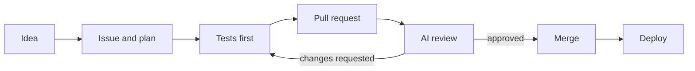

# Synaptix Innovations

We help engineering teams automate their entire delivery process  from code commit to production with built-in security, gradual rollouts, and real-time monitoring.

## What we build

- **Automated CI/CD** — pipelines that test, scan, and deploy without manual steps
- **Zero-downtime releases** — gradual rollouts that roll back automatically if something breaks
- **Cloud infrastructure** — scalable, code-defined environments that work the same everywhere
- **Intelligent monitoring** — dashboards and alerts so you know about issues before your users do
- **AI-powered code review** — automated analysis on every pull request

📍 Canada · 🌐 [synaptixtech.net](https://www.synaptixtech.net) · ✉️ info@synaptixtech.net

<!-- synaptix-stats:start -->

## Proof, not promises

- 839 AI code reviews across 483 merged pull requests
- Tests first: every change starts from a failing test
- Each pull request gets an AI review before it merges
- The checks are tested too: we break them on purpose to prove they can fail

## Delivery activity

| All time | |
|---|---:|
| Reviews | 839 |
| Codex reviews | 793 |
| Claude reviews | 23 |
| PRs merged | 483 |
| Median rounds to approval | 1 |

## How we work

Counts only; generated from our own review log. Reviews are automated (Codex, with a Claude fallback).

<!-- synaptix-stats:end -->
