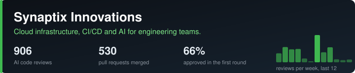
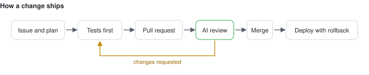
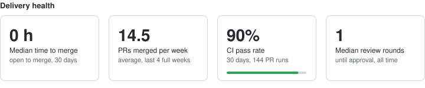
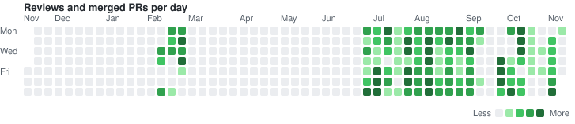
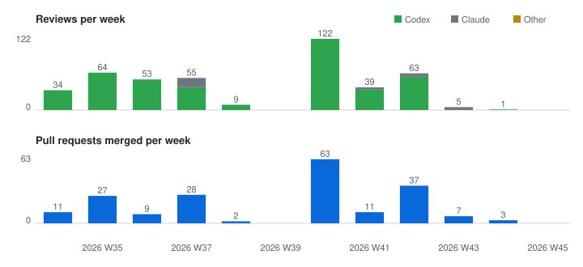
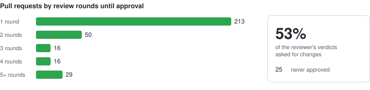

<!-- synaptix-stats:start -->

We build delivery pipelines and infrastructure as code, and we bring AI into development, review and testing under the same engineering controls.

## Delivery engineering

- **Pipelines as code.** GitHub Actions and Jenkins pipelines (20 stages on our reference platform), GitOps with ArgoCD, and canary releases with Argo Rollouts (10% → 50% → 100%) that roll back automatically when the error rate reaches 5%.
- **Infrastructure as code.** Terraform for AWS: EKS, RDS, KMS, EFS and the network around them. Our own server's configuration is versioned too, and every change to it goes through the same pull-request review.
- **Security in the pipeline.** Secret scanning, image and IaC scanning, SBOM generation, image signing and attestation with Cosign, and admission policies that block unsafe workloads.
- **Product: [startup-pipeline-template](https://github.com/Synaptix-Innovations/startup-pipeline-template).** A delivery pipeline that runs on free tiers: CI, a review gate that fails closed, a gated deploy and a rollback that is drilled, not just documented.

Clouds: **AWS** (EKS, RDS, KMS, Terraform; see the reference projects), and **Azure and GCP**, on which projects are in progress.

## AI adoption

- **Development.** Our AI agents follow one written workflow: issue, plan, a failing test first, pull request, review, verified close. Rules and gates decide what is finished, not the agent.
- **Review.** Pull requests go to an AI reviewer: Codex first, Claude when Codex is unavailable. 369 of 425 pull requests merged since 1 July 2026 had an AI review before merging. Across our whole history it is 395 of 565, because our earliest projects predate the review gate.
- **Testing.** We test our own checks: 629 deliberate breakages, each of which must make a test fail, all proven in the nightly run of 11 November 2026. On the reference platform, a 13-stage nightly suite runs mutation testing, load tests (k6), dynamic security scans (OWASP ZAP, Nuclei) and an AI analysis.
- **Shared memory across models.** One governed knowledge base feeds our AI agents. A nightly job writes the same memory snapshot for Claude, Codex, Gemini and Opencode. A registry records who owns each store and how long it is kept, and new facts become durable only after human review. When two agents change the same note, the sync stops publishing it until a person decides. Status on 11 November 2026: in sync, no open conflicts.
- **Operations.** A Discord bridge to AI command-line agents, daily project digests, and scheduled health and security checks that alert to Discord and Telegram.

Monitoring, plainly: the dashboards (Prometheus, Grafana) belong to the reference platform. Our own server runs scheduled checks with alerts and has no dashboards.

## Stack

AWS · Oracle Cloud · Terraform · Kubernetes · ArgoCD · Argo Rollouts · Jenkins · GitHub Actions · Docker · Trivy · Cosign · Kyverno · SonarQube · Prometheus · Grafana · k6 · OWASP ZAP · Java/Spring Boot · Python · Bash · Next.js · PostgreSQL · Cloudflare Workers · Claude · Codex

## How a change ships

## Reference platform

Borod Bank is our own reference project, not client work: a banking app delivered through a three-tier pipeline to Kubernetes by GitOps.

| Repository | Contents |
|---|---|
| [borod-bank-ci](https://github.com/Synaptix-Innovations/borod-bank-ci) | pipelines and application |
| [borod-bank-cd](https://github.com/Synaptix-Innovations/borod-bank-cd) | GitOps manifests, rollouts, monitoring |
| [borod-bank-infra](https://github.com/Synaptix-Innovations/borod-bank-infra) | Terraform for AWS EKS |
| [jenkins-setup](https://github.com/Synaptix-Innovations/jenkins-setup) | Jenkins controller image |
| [borod-bank-docs](https://github.com/Synaptix-Innovations/borod-bank-docs) | architecture and decisions |

## Evidence

- 943 AI code reviews across 565 merged pull requests
- 369 of 425 pull requests merged since 1 July 2026 had an AI review first

Counts only, generated daily from our own review log. They cover the repositories of this organisation and our website, private ones only as totals. Reviews are automated (Codex, with a Claude fallback).

## Work with us

- **Pipeline audit.** We read your pipeline and infrastructure code and return a written list of gaps in security, rollback and cost, each with its fix.
- **AI review and test adoption.** We add an AI reviewer to your pull requests, with a fallback and a gate that fails closed. We also set up tests that prove your checks can fail.

Canada · [synaptixtech.net](https://www.synaptixtech.net) · info@synaptixtech.net

<!-- synaptix-stats:end -->
